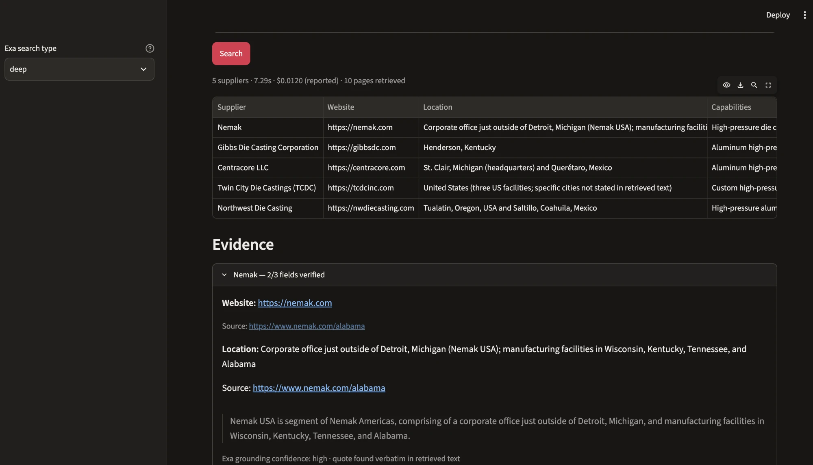
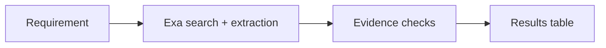

# Automotive Supplier Discovery

Describe the supplier you need in plain English and get back five candidates. Each one's location, capabilities and certifications link to the page they came from. I built it on Exa's search API, and also compared two of Exa's search modes on speed, cost and how much they could back up.



## Why I built this

Finding automotive suppliers is mostly manual vetting: you find a candidate, then dig through its site to confirm where it makes things, what processes it runs, and whether it holds IATF 16949. A search tool only saves time if you can trust what it tells you. So I set one rule: the app doesn't state anything it can't point to. Every field comes with a source URL and a quote from that page. If there's no support, it says "Not verified".

## How it works



A single Exa `/search` call does the retrieval and the extraction. I give it a small output schema (name, website, location, capabilities, certifications) and a system prompt with the rules: only actual suppliers (no directories or news sites), and nothing the page doesn't say. Exa returns the fields plus a citation URL for each one.

Exa's citations include a URL but not the supporting text, so I also ask for a short verbatim quote per field. Then I check the result in Python:

- A field shows only if it has a value, a quote and a source. Otherwise it's "Not verified".
- Each quote is matched against the page text Exa returned. If it can't be found word for word, the app flags it for review.
- Certifications have to be named in their quote. In testing, the model would sometimes add an ISO standard from somewhere else on the page.
- Certifications read "Mentioned on site", never "Certified". If the source is a third-party page instead of the supplier's own site, the label names that domain.
- Duplicate companies are removed by domain.

Code: `supplier_search.py` (Exa call and checks), `app.py` (Streamlit UI), `eval.py` and `summarize.py` (evaluation).

## Evaluation

I ran 7 queries through both of Exa's search modes that support structured output, using the same request the app sends:

- `auto` is the default and runs a single search.
- `deep` runs several searches per request. It's meant for cases where the facts you want are spread across different pages, which is usually true for suppliers.

(`lite` is faster still, but it doesn't support output schemas.)

The queries cover different materials, processes, regions and certifications:

1. North American manufacturers of aluminum die-cast components for EV powertrains
2. Plastic injection molding suppliers in Mexico with IATF 16949 for automotive interior parts
3. Precision CNC machining suppliers in Michigan for automotive transmission components
4. Suppliers of hot-stamped boron steel body-in-white parts in the United States
5. Wire harness manufacturers in Eastern Europe serving automotive OEMs
6. Rubber and elastomer sealing suppliers for EV battery enclosures in North America
7. Powder metallurgy gear manufacturers for automotive applications in Germany

Results from one run of each query in each mode (November 2026). Costs are what the API reported. "Fields verified" means location, capabilities and certifications that passed the checks above.

| Mode | Queries | Avg latency (s) | Avg cost (USD) | Avg suppliers returned | Fields verified |
| --- | --- | --- | --- | --- | --- |
| auto | 7 | 4.6 | 0.0070 | 4.6 | 76/96 (79%) |
| deep | 7 | 10.1 | 0.0120 | 5.0 | 101/105 (96%) |

`deep` was about twice as slow and 70% more expensive, but noticeably more complete. It returned five suppliers for every query, while `auto` came back short on two. And 96% of its fields had evidence, against 79% for `auto`.

How much the two modes agreed depended on the market. For powder-metal gears in Germany, they returned the same five companies. For Eastern European wire harnesses, they shared none: `deep` found smaller regional plants, and `auto` leaned toward big names like LEONI and Sumitomo.

## Limits

- 7 queries with one run each is a small sample, and I haven't scored relevance yet (whether the suppliers returned actually match the query).
- The website is the model's pick of the company homepage. I filter out social sites, but a directory page still got through twice in 14 runs, both on `auto`.
- "Mentioned on site" means the page mentions the certification. It doesn't mean the certificate is current. Checking it against the IATF registry would be the next step.
- A quote that comes from a page Exa read but didn't return as text gets flagged, not dropped.

If I kept going, I'd score relevance (by hand first, then with an automated judge), add more queries, a comparison against another search API, and monitoring for supplier changes with Exa Monitors.

## Running it

You need Python 3.10+ and an Exa API key from https://dashboard.exa.ai/api-keys.

```bash
git clone https://github.com/walidelkhatib/exa-supplier-discovery.git && cd exa-supplier-discovery
python3 -m venv .venv && source .venv/bin/activate
pip install -r requirements.txt
cp .env.example .env   # add your key after EXA_API_KEY=
streamlit run app.py   # opens http://localhost:8501
```

At list prices a search costs about $0.012 in `deep` mode or $0.007 in `auto`. The app shows what each search actually cost.

To rerun the evaluation (14 searches, about $0.13):

```bash
python eval.py              # writes eval_results.csv
python eval.py --limit 2    # quick smoke test
python summarize.py         # prints the results table
```
