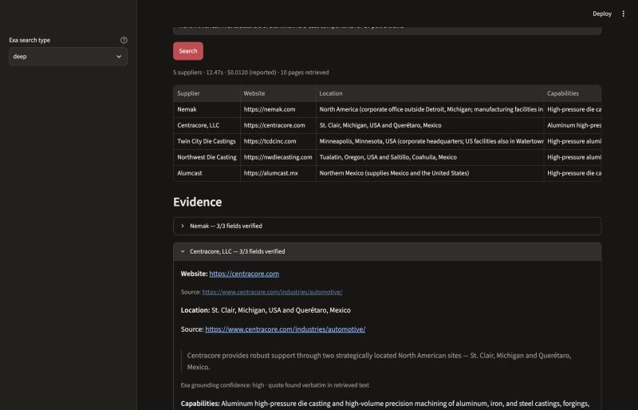
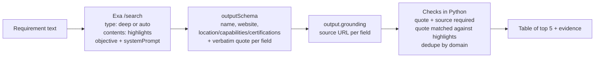

# Automotive Supplier Discovery (Exa)

Type a supplier requirement in plain English ("North American manufacturers of aluminum die-cast components for EV powertrains") and get the top 5 suppliers, where every location, capability and certification links to the page and quote it came from. A small evaluation compares two Exa search types on relevance, latency and cost.



## Why this use case

Procurement and sourcing teams spend hours vetting suppliers: finding candidates, then checking each one's location, processes and certifications against its website. A search tool is only useful here if its claims are checkable. So this app never states a fact without a source URL and a verbatim snippet, and anything the retrieved text doesn't support shows **"Not verified"**. Certifications are shown as "Mentioned on site", never "Certified".

## How it works



- **One Exa call does retrieval and extraction.** `/search` with `outputSchema` returns structured fields plus `output.grounding` (a citation URL for each field), so no separate LLM is needed.
- **Snippets.** Grounding gives URLs but not quotes, so the schema asks for a verbatim `*_quote` per field. The app checks each quote against the highlights Exa returned and flags quotes it can't find verbatim.
- **"Not verified" rule.** A field is shown only when it has a value, a quote, and a source URL (from grounding, or a retrieved page that contains the quote). Otherwise it's "Not verified".
- **Certifications are checked in code.** Any standard (IATF 16949, ISO 14001, …) not named in its quote is dropped, and the label says "Mentioned on site" only when the source is the supplier's own domain (otherwise "Mentioned on <domain>").
- **Rules go in `systemPrompt`, intent in `query`.** The user's text is sent unchanged as the query. Keep/drop rules (no directories, no news, no inferred certifications) go in `systemPrompt`, and ranking intent goes in `objective`.

Files: `supplier_search.py` (Exa call + checks), `app.py` (Streamlit UI), `eval.py` / `summarize.py` (evaluation), `queries.txt` (eval queries).

## Evaluation

`eval.py` runs every query in `queries.txt` with two Exa search types, using the same request the app makes:

- **auto**: Exa's default. One search, then structured extraction.
- **deep**: runs several searches per request. Exa recommends it when schema fields sit on different pages, which supplier facts often do.

(`lite` is faster and cheaper but rejects `outputSchema`, so it can't run this pipeline.)

For each query and mode it records latency, cost (`costDollars.total` from the response; otherwise estimated from exa.ai/pricing and labeled "estimated"), the supplier websites shown, and how many of the location/capabilities/certifications fields passed the evidence checks. `relevant_in_top5` is scored by hand: how many of the suppliers shown are real companies matching the request.

**Queries** (`queries.txt`), mixing materials, processes, regions and certifications:

1. North American manufacturers of aluminum die-cast components for EV powertrains
2. Plastic injection molding suppliers in Mexico with IATF 16949 for automotive interior parts
3. Precision CNC machining suppliers in Michigan for automotive transmission components
4. Suppliers of hot-stamped boron steel body-in-white parts in the United States
5. Wire harness manufacturers in Eastern Europe serving automotive OEMs
6. Rubber and elastomer sealing suppliers for EV battery enclosures in North America
7. Powder metallurgy gear manufacturers for automotive applications in Germany

**Results** (real measurements, one run per query and mode, November 2026; cost is what the API reported):

<!-- Regenerate with `python summarize.py` after scoring relevant_in_top5 -->
| Mode | Queries | Avg latency (s) | Avg cost (USD) | Avg suppliers returned | Fields verified | Avg relevant in top 5 |
| --- | --- | --- | --- | --- | --- | --- |
| auto | 7 | 4.6 | 0.0070 | 4.6 | 76/96 (79%) | not scored yet |
| deep | 7 | 10.1 | 0.0120 | 5.0 | 101/105 (96%) | not scored yet |

**What I noticed:**

- `deep` took about 2.2× as long and cost about 1.7× as much, and was more complete. It returned 5 suppliers on every query, while `auto` returned 3–4 on two queries. It also filled 96% of fields with cited evidence, against 79% for `auto`.
- The two modes overlapped where the market is concentrated (powder-metal gears in Germany: the same 5 companies). They diverged on fragmented markets like Eastern European wire harnesses, where none of the 5 suppliers matched between the modes: `deep` found smaller regional plants, and `auto` included more large multinationals (LEONI, Sumitomo, Kromberg & Schubert).
- The evidence checks caught real problems in testing: models listing a certification their quote didn't mention, and third-party pages (an M&A blog, a directory) standing in for a supplier's own site.

<!-- TODO: add a sentence on relevance once relevant_in_top5 is scored -->

## Limits and next steps

- Relevance is scored by hand on 7 queries with one run each, so the sample is small.
- The "website" is the model's pick of the company homepage. Social sites are filtered out, but a directory page can still slip through: 2 of 14 runs did this, both on `auto`.
- "Mentioned on site" means the text exists, not that a certificate is valid. Checking against a registry (e.g. IATF's database) would be the next step.
- Quotes are matched against highlights only. A quote the model read on a page but that isn't in the returned highlights is flagged for review, not dropped.
- Next: more queries, an LLM-as-judge for relevance, a comparison with another search API, recurring supplier monitoring (Exa Monitors), and the Exa Agent API for longer list-building and enrichment runs.

## How to run

Requires Python 3.10+ and an Exa API key (https://dashboard.exa.ai/api-keys).

```bash
git clone <this repo> && cd exa-supplier-discovery
python3 -m venv .venv && source .venv/bin/activate
pip install -r requirements.txt
cp .env.example .env   # then put your key after EXA_API_KEY=
streamlit run app.py   # opens http://localhost:8501
```

Each search costs about $0.012 (`deep`) or $0.007 (`auto`) at Exa's list prices; the app shows the actual cost the API reports.

Evaluation (14 searches, about $0.13):

```bash
python eval.py              # all queries -> eval_results.csv
python eval.py --limit 2    # quick smoke test
# fill in relevant_in_top5 by hand, then:
python summarize.py         # prints the markdown results table
```
